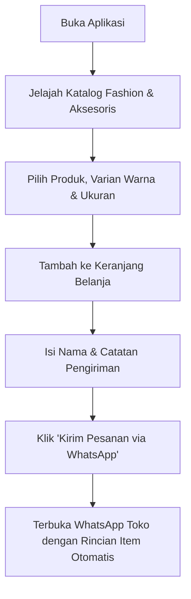
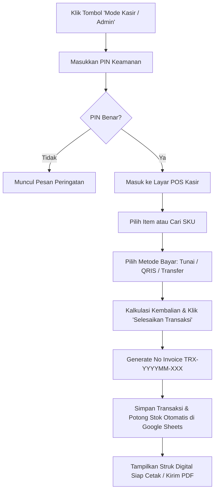

# PRODUCT REQUIREMENT DOCUMENT (PRD)
# Sistem Toko Fashion India & Aksesoris (Katalog Online & Kasir POS)

================================================================================
ZONA ATAS: SPESIFIKASI KEBUTUHAN PRODUK (BLUEPRINT AWAL)
================================================================================

## 1. NAMA PROJEK & PROBLEM STATEMENT
- **Nama Resmi Projek:** "PAC (Pink ACcessories) - Indian Fashion & Accessories" (Diselaraskan dengan logo & identitas toko riil pengguna).
- **Problem Statement:** 
  Toko busana dan perhiasan India memiliki keragaman varian produk yang tinggi (seperti Saree, Kurti, Lehenga, Dupatta, Gelang Bangles, Kalung Kundan, Bindi, dll) dengan detail ukuran (S/M/L/XL/Free Size), warna, dan motif yang kaya. Saat ini sering terjadi kendala:
  1. Pelanggan luar kota/online sulit melihat katalog koleksi terbaru beserta detail varian stok yang tersedia.
  2. Pemesanan via chat sering memakan waktu karena admin harus mengetik ulang total belanja dan mengecek stok manual.
  3. Transaksi kasir di toko fisik membutuhkan pencatatan cepat, kalkulasi otomatis, cetak nota/struk digital, serta pengamanan laporan keuntungan agar tidak terlihat sembarang orang.
- **Solusi ZettBOT:**
  Membangun aplikasi All-in-One modern berbasis Google Apps Script & Google Sheets yang menggabungkan:
  - **Katalog Publik Pelanggan:** Etalase interaktif bergaya *PAC Royal Indian Luxury* (Nuansa Magenta/Fuchsia `#c2185b`, Deep Plum `#581845`, & Aksen Emas Mewah `#d4af37`), filter kategori pill, kartu 2 kolom rounded ala mockup mobile, modal bottom sheet pemilih varian (ukuran/warna), keranjang belanja, dan pemesanan instan ke WhatsApp Admin Toko.
  - **Panel Kasir & Admin (POS):** Dilindungi PIN pengaman untuk input transaksi kasir toko (Tunai, QRIS, Transfer), cetak nota digital, manajemen stok barang masuk/keluar, dan laporan omzet/laba bersih harian.

---

## 2. PERAN PENGGUNA (USER ROLES) & HAK AKSES
1. **Pelanggan / Tamu (Mode Publik):**
   - Menjelajahi katalog produk fashion & aksesoris.
   - Filter berdasarkan kategori (Saree, Kurti, Lehenga, Aksesoris, dll).
   - Melihat foto produk resolusi tinggi, deskripsi bahan, varian ukuran, dan pilihan warna.
   - Memasukkan barang ke keranjang belanja & checkout langsung terhubung ke WhatsApp Admin dengan format pesanan rapi.
2. **Kasir / Staff Toko (Mode Kasir - Akses PIN):**
   - Membuka halaman kasir Point of Sale (POS).
   - Memilih produk atau scan barcode/SKU, menghitung subtotal, diskon, dan kembalian.
   - Memilih metode pembayaran (Tunai, QRIS, Transfer Bank).
   - Menerbitkan struk/nota digital (bisa dicetak atau dibagikan via WhatsApp).
   - Memotong stok otomatis di Google Sheets.
3. **Owner / Admin Toko (Mode Pengaturan - Akses PIN):**
   - Menambah, mengubah, atau menonaktifkan produk beserta foto dan varian harga modal/jual.
   - Melakukan penyesuaian stok (*Stock In / Opname*).
   - Memantau rekap laporan laba rugi, total transaksi harian/bulanan.
   - Mengatur nama toko, alamat, kontak WhatsApp, tarif rekening/QRIS, dan mengganti PIN keamanan.

---

## 3. ARSITEKTUR & LINGKUNGAN KERJA
- **Frontend:** Single Page Application (SPA) responsif modern (Mobile First & Desktop Ready), HTML5, CSS3 Custom Modern (Anti-AI Aesthetics: *Royal Indian Luxury* Palet Maroon `#6b1426` & Champagne Gold `#d4af37`), Vanilla JavaScript dengan Client-Side In-Memory State Caching untuk perpindahan tab 0 detik tanpa reload.
- **Backend:** Google Apps Script (`code.gs`) sebagai controller API non-destruktif dan penyedia endpoint Web App.
- **Database:** Google Sheets (terhubung ke Google Drive pemilik toko, gratis selamanya, tanpa limit kuota sewa server database bulanan).
- **Arsitektur Berkas (Pondasi Awal):**
  - `code.gs`: Backend Controller (penanganan `doGet`, perutean aksi API, generator ID unik transaksi, pencatatan sheet).
  - `setup.gs`: Inisialisasi basis data idempoten & *Safe Migration* (membuat tab sheet & header otomatis tanpa risiko menimpa data riil).
  - `index.html`: Antarmuka lengkap terintegrasi (Katalog Publik, Keranjang Belanja WhatsApp, Kasir POS, Manajemen Stok & Laporan).

---

## 4. ALUR KERJA APLIKASI (USER FLOW)

### A. Alur Pelanggan (Katalog Online & Pesan via WhatsApp):

### B. Alur Kasir Toko & Pengurangan Stok (POS):

---

## 5. DESAIN BASIS DATA (GOOGLE SHEETS SCHEMA)
*Catatan Kepatuhan ZettBOT: Nama tab lembar kerja DILARANG menggunakan karakter garis bawah (_).*

### Tab 1: `DataProduk`
Menyimpan master data busana dan aksesoris.
- Kolom A (Indeks 0): `IdProduk` (Format: `PRD-001`, string)
- Kolom B (Indeks 1): `SkuBarcode` (Format: `SKU-IND-001`, string unik)
- Kolom C (Indeks 2): `NamaProduk` (Contoh: "Saree Silk Banarasi Gold Emroidery", string)
- Kolom D (Indeks 3): `Kategori` (Pilihan: "Saree", "Kurti", "Lehenga", "Dupatta", "Perhiasan & Gelang", "Aksesoris", string)
- Kolom E (Indeks 4): `VarianWarna` (Contoh: "Maroon, Gold, Royal Blue", string)
- Kolom F (Indeks 5): `VarianUkuran` (Contoh: "All Size" / "M, L, XL", string)
- Kolom G (Indeks 6): `HargaModal` (Harga pokok kulakan/modal, angka)
- Kolom H (Indeks 7): `HargaJual` (Harga jual ke konsumen, angka)
- Kolom I (Indeks 8): `Stok` (Jumlah stok fisik terkini, angka)
- Kolom J (Indeks 9): `FotoUrl` (URL gambar produk resolusi tinggi, string)
- Kolom K (Indeks 10): `Deskripsi` (Detail bahan kain/material, string)
- Kolom L (Indeks 11): `Status` ("Aktif" / "Nonaktif", string)

### Tab 2: `DataTransaksi`
Menyimpan ringkasan kepala transaksi penjualan kasir.
- Kolom A (Indeks 0): `IdTransaksi` (Format sekuensial: `TRX-YYYYMM-XXX`, string)
- Kolom B (Indeks 1): `Tanggal` (Format: `YYYY-MM-DD HH:mm:ss`, string)
- Kolom C (Indeks 2): `NamaKasir` (Nama petugas yang bertugas, string)
- Kolom D (Indeks 3): `NamaPelanggan` (Nama pembeli, string)
- Kolom E (Indeks 4): `TotalItem` (Jumlah pcs produk yang dibeli, angka)
- Kolom F (Indeks 5): `TotalBelanja` (Total nominal belanja, angka)
- Kolom G (Indeks 6): `Diskon` (Potongan harga, angka)
- Kolom H (Indeks 7): `TotalAkhir` (Nominal bersih wajib bayar, angka)
- Kolom I (Indeks 8): `MetodeBayar` ("Tunai", "QRIS", "Transfer Bank", string)
- Kolom J (Indeks 9): `JumlahBayar` (Uang yang diserahkan pelanggan, angka)
- Kolom K (Indeks 10): `Kembalian` (Uang kembalian, angka)
- Kolom L (Indeks 11): `Catatan` (Keterangan opsional transaksi, string)

### Tab 3: `DetailTransaksi`
Menyimpan rincian item barang pada setiap transaksi untuk audit & analisis penjualan terlaris.
- Kolom A (Indeks 0): `IdDetail` (Format: `DTL-YYYYMM-XXXXX`, string)
- Kolom B (Indeks 1): `IdTransaksi` (Relasi ke Tab DataTransaksi, string)
- Kolom C (Indeks 2): `IdProduk` (ID Produk, string)
- Kolom D (Indeks 3): `NamaProduk` (Nama produk pada saat transaksi, string)
- Kolom E (Indeks 4): `VarianDipilih` (Warna / Ukuran yang dibeli, string)
- Kolom F (Indeks 5): `HargaSatuan` (Harga jual per pcs, angka)
- Kolom G (Indeks 6): `Jumlah` (Qty beli, angka)
- Kolom H (Indeks 7): `Subtotal` (HargaSatuan * Qty, angka)
- Kolom I (Indeks 8): `HargaModalSatuan` (Untuk perhitungan laba riil, angka)
- Kolom J (Indeks 9): `LabaKotor` (Subtotal - (HargaModalSatuan * Qty), angka)

### Tab 4: `PengaturanToko`
Menyimpan identitas toko dan konfigurasi sistem.
- Kolom A (Indeks 0): `Kunci` (`NamaToko`, `Alamat`, `NoWhatsApp`, `PinKasir`, `PesanNota`, `InfoRekening`)
- Kolom B (Indeks 1): `Nilai` (Value konfigurasi)

---

## 6. ATURAN VALIDASI, SISTEM KEAMANAN & LOGIKA KHUSUS
1. **Penomoran Kode Transaksi Otomatis (Anti-Tabrakan):**
   - Format: `TRX-YYYYMM-001`, `TRX-YYYYMM-002`, dst.
   - Menggunakan pemindaian nomor urut tertinggi (MAX + 1) dengan `LockService.getScriptLock()` pada Google Apps Script untuk menjamin data aman saat multi-device mengakses kasir secara bersamaan.
2. **Proteksi Akses PIN Kasir:**
   - Akses publik hanya diizinkan melihat katalog dan keranjang WhatsApp.
   - Menuju tab Kasir, Stok, dan Laporan Keuangan memerlukan otentikasi PIN (Default: `1234`, dapat diganti via menu Pengaturan Toko).
3. **Pengurangan Stok Otomatis & Proteksi Stok Negatif:**
   - Transaksi kasir langsung memotong stok fisik di tab `DataProduk`.
   - Sistem menolak checkout jika kuantitas melebihi stok yang tersedia.
4. **Index-Based Column Mapping:**
   - Backend membaca baris menggunakan array index konstan (`COL_PRODUK.ID = 0`, `COL_PRODUK.NAMA = 2`, dsb) agar sistem kebal jika nama header di Google Sheets disunting pengguna secara manual.

---

## 7. RENCANA ANTARMUKA PENGGUNA (UI/UX)
- **Tema Desain:** *Royal Indian Luxury (Anti-AI Human Aesthetic)*
  - Warna Dasar: Deep Burgundy / Velvet Maroon (`#6b1426`), Warm Gold Accent (`#d4af37`), Soft Gold Highlight (`#f7e7ce`), Slate Dark Text (`#1e293b`), Clean White Canvas (`#ffffff`).
  - Tipografi: Kombinasi Serif Mewah untuk Tajuk (*Playfair Display* / *Cinzel*) dan Sans-Serif Elegan yang mudah dibaca untuk angka dan tabel (*Inter* / *Outfit*).
  - Ikon: Vektor SVG murni (tajam, konsisten, anti-emoji murahan).
- **Struktur Halaman Utama:**
  1. **Header & Navbar:** Logo / Nama Toko, Badge Keranjang Belanja, Tombol Pengalih Mode (Katalog Pelanggan vs Akses Kasir).
  2. **Tampilan Pelanggan (Katalog):**
     - Banner sambutan koleksi busana India eksklusif.
     - Filter cepat Kategori (Semua, Saree, Kurti, Lehenga, Dupatta, Gelang & Perhiasan).
     - Search bar pencarian instan nama atau varian produk.
     - Kartu Produk Mewah (Foto produk jernih, badge stok, badge harga, tombol "Pilih Varian & Pesan").
     - Drawer / Modal Keranjang Belanja dengan tombol "Kirim Order via WhatsApp".
  3. **Tampilan Kasir (POS):**
     - Panel kiri: Grid produk cepat dengan pencarian SKU / nama produk.
     - Panel kanan: Daftar kasir berjalan (item, qty stepper (+/-), subtotal, diskon, tombol bayar).
     - Modal Pembayaran: Pilihan Tunai (kalkulasi kembalian otomatis), QRIS (tampilan kode QR), atau Transfer Bank.
     - Modal Nota / Struk Digital dengan opsi Cetak Struk dan Kirim Nota WhatsApp.
  4. **Tampilan Manajemen Stok & Produk (Admin):**
     - Tabel responsif *Fluid Typography* (anti teks kepotong).
     - Tombol Tambah Produk Baru, Edit, & Tambah Stok Cepat (*Quick Restock*).
  5. **Tampilan Laporan & Pengaturan:**
     - Kartu Ringkasan Metrik 3 Kolom Kompak (Total Omzet, Laba Bersih, Total Transaksi Hari Ini).
     - Form Pengaturan Identitas Toko, No WhatsApp Admin, dan Ubah PIN Kasir.

---

## 8. KRITERIA PENGUJIAN (ACCEPTANCE CRITERIA)
- [ ] Pengguna dapat melihat daftar produk di katalog publik lengkap dengan foto, harga, dan kategori.
- [ ] Pelanggan dapat memasukkan produk ke keranjang dan mengklik tombol WhatsApp untuk membuka pesan chat dengan rincian pesanan yang rapi.
- [ ] Mengklik menu Kasir / Admin memunculkan modal PIN pengaman.
- [ ] Transaksi kasir dapat memproses metode pembayaran Tunai, QRIS, dan Transfer, serta mencetak nota struk digital.
- [ ] Transaksi kasir otomatis mengurangi sisa stok produk di tab `DataProduk` Google Sheets.
- [ ] Nomor transaksi berurutan rapi sesuai format `TRX-YYYYMM-XXX`.
- [ ] Skrip inisialisasi `setup.gs` bersifat non-destruktif (*Safe Migration*) dan tidak menghapus data riil saat dijalankan ulang.

================================================================================
ZONA BAWAH: MASTER CONTEXT & LOGIKA SISTEM TERKINI (LIVING CONTEXT)
================================================================================
- **Status Arsitektur Aktif:** Standar Google Apps Script (`code.gs`, `setup.gs`, `index.html`) terhubung ke Google Sheets Database.
- **PIN Kasir Default:** `1234`
- **Konvensi Nama Sheet Aktif:**
  - `DataProduk`
  - `DataTransaksi`
  - `DetailTransaksi`
  - `PengaturanToko`
  - `DataPengguna`
- **Aturan Nomor Otomatis Aktif:**
  - Produk: `PRD-XXX`
  - SKU Barcode: `SKU-IND-XXX`
  - Transaksi: `TRX-YYYYMM-XXX`
  - Detail Transaksi: `DTL-YYYYMM-XXXXX`
  - Pengguna: `USR-XXX`
- **Log Pembaruan Resmi:**
  - *v1.0.0 (Inisialisasi Blueprint):* Penyusunan PRD untuk Sistem Toko Fashion India & Aksesoris (Katalog Online & Kasir POS).
  - *v1.1.0 (Mode Pratinjau Ganda):* Penambahan Device Viewport Switcher di `index.html` dengan mode default Mobile (HP) dan tombol pengalih ke Desktop View.
  - *v1.3.0 (RBAC, OTP & Taksonomi India Lengkap):* Integrasi foto pemilik & butik PAC, sistem autentikasi OTP, hierarki hak akses (ADMIN-G GAYA, ADMIN PINKY/VICKY/TISH, OPERATOR WIDYA/MILA/ROSSI), form operator khusus, serta display filter multi-tier kategori pakaian & aksesoris India.
  - *v1.4.0 (Gateway Pelanggan Murni, Audio MP3 Toko & Relokasi Staf ke Setting):* Pembersihan halaman utama khusus untuk akses pelanggan/tamu via nama & OTP; pemindahan login ADMIN-G, ADMIN, dan OPERATOR ke menu Setting & Stok dengan proteksi PIN; integrasi pemutar musik `assets/mp3 sound-Awal.mp3` yang otomatis berbunyi saat masuk display katalog dan otomatis mati saat menekan tombol Keluar / Quit atau berpindah menu.
  - *v1.5.0 (English Premium Landing Gateway & OTHERS Input Flexibility):* Tampilan awal (Gateway) Mobile dan Desktop resmi menggunakan Bahasa Inggris dengan teks: "Welcome To The Premium Indian Fashion & Accesories", "THE PAC ~ Pinky Accesories and Indian Fashion", "Jl.Teuku Cik Ditiro No. 22, Medan, Indonesia"; penambahan opsi OTHERS dinamis pada Sub-Kategori dan Bahan Material di modal input operator untuk mengakomodasi Sepatu Kerajaan Mojari, Mehendi/Innai, Kajal mata, dan aksesoris lainnya.
  - *v1.6.0 (Fitur Edit Produk, Live Preview Foto & Koreksi Gambar Mojari):* Penambahan modal Edit Produk & Ganti Foto dengan live preview pada tabel Setting & Stok serta shortcut di modal varian; penggantian foto default Sepatu Kerajaan INDIA Mojari ke aset asli bordir emas `assets/Sepatu-Mojari.jpg`.
  - *v1.7.0 (Pencetakan Stok, Invoice Customer, Analitik Sisa Stok Harian/Mingguan/Bulanan & Alert Re-Order < 10 Item):* 
    1. **Pencetakan Stok Barang:** Modal pratinjau dokumen cetak A4/PDF (`#printStockModal`) lengkap dengan kop resmi butik PAC, tanggal, nama petugas, rincian SKU, nama item, sub-kategori, jenis kain, harga jual, sisa stok, status aman/re-order, total valuasi modal, dan kolom tanda tangan ganda.
    2. **Invoice Penjualan per Customer:** Modal faktur penjualan customer terpadu (`#customerInvoiceModal`) dengan pencarian cepat nama/kontak/TRX, rincian produk, subtotal, diskon, grand total, metode pembayaran, tombol cetak PDF, serta tombol integrasi kirim faktur langsung ke WhatsApp pelanggan dengan format rapi.
    3. **Analisis Sisa Stok Periodik (Hari Ini, Minggu Ini, Bulan Ini):** Switcher filter dinamis (`#btnPeriodDaily`, `#btnPeriodWeekly`, `#btnPeriodMonthly`) yang mengalkulasi secara realtime jumlah sisa stok fisik, valuasi modal aset toko, kuantitas item terjual, omzet penjualan, dan estimasi laba bersih.
    4. **Peringatan & Re-Order Stok Kritis (< 10 Item):** Banner peringatan otomatis (`#lowStockAlertBanner`), filter tab `🚨 Stok Kritis (< 10 Pcs)`, tombol `+10` Quick Restock, dan tombol Cetak Surat Re-Order Supplier (`#reorderSupplierModal`) dengan kalkulasi rekomendasi unit order pengaman (target buffer 25 pcs) dan estimasi anggaran kulakan.
  - *v1.7.1 (Penataan Header Branding Gateway: Background Merah, Teks Putih & Baris Baru):* Pembaruan visual pada tajuk utama `.gateway-heading` dengan latar belakang merah tebal (*Royal Crimson Red* `#b91c1c`), teks putih bersih `#ffffff`, dan pemisahan eksplisit menjadi 2 baris terstruktur: Baris 1: `THE PAC ~ Pinky Accesories`, Baris 2: `Indian Fashion` untuk mencegah teks terpotong canggung di layar mobile.
  - *v1.8.0 (Standarisasi Pencetakan Format PDF Size A4 & Integrasi Faktur POS):*
    1. **Penguncian Standar Kertas A4:** Penerapan aturan CSS `@page { size: A4 portrait; margin: 12mm 15mm 15mm 15mm; }` dan optimalisasi `@media print` untuk seluruh dokumen cetak resmi toko (Faktur Invoice, Laporan Stok & Valuasi, dan Surat Re-Order Supplier) agar terkonfigurasi otomatis ke ukuran A4 pada jendela cetak/Simpan PDF browser.
    2. **Proteksi Pemotongan Halaman (Anti-Break):** Penerapan `page-break-inside: avoid;` dan `break-inside: avoid;` pada baris tabel barang, tanda tangan, dan kotak kalkulasi total agar tidak terpotong canggung saat dicetak/diekspor ke PDF multi-halaman.
    3. **Integrasi Meja Kasir POS ke Faktur A4:** Penyediaan tombol `📄 Cetak Faktur A4 (PDF)` langsung dari modal sukses transaksi kasir (`receiptModal`), yang secara otomatis memuat transaksi tersebut ke modal faktur A4 lengkap dan membuka dialog simpan PDF tanpa perlu mencari manual di riwayat.
    4. **Label Aksi Seragam:** Pembaruan seluruh tombol aksi cetak di modal dokumen menjadi `📄 Simpan / Cetak PDF (Size A4)`.
  - *v1.9.0 (Redesign DesktopView & MobileView Sesuai Referensi Gambar 1.jpg, 2.jpg, 3.jpg):*
    1. **Top Utility Bar & Main Header (`1.jpg` & `2.jpg`):** Utility bar promo aplikasi, panduan cara belanja, dan belanja ke toko. Main header resmi brand V&T (VIC & TIS) dengan search bar rounded, location picker pill *"Mau belanja di mana?"*, keranjang belanja ber-badge oranye, dan tombol login/masuk.
    2. **Sub-Nav Bar (`1.jpg`):** Dropdown kategori (`⊞ Kategori ▾`), shortcut `📢 What's New`, `📦 Just Arrived`, `🎉 10.10`, dan quick links Saree, Kurta, Sherwani, Lehenga, Aksesoris, & Wedding.
    3. **Split Hero Section Brand Story (`1.jpg`):** Kolom kiri sejarah & narasi V&T VIC & TIS (sejak 2022 oleh Vicky & Hritish) beserta daftar penerimaan Gift Certificates & Shopping Vouchers; kolom kanan dual promo cards (*Custom Software Development* & *PAC Pink Accessories*) + foto showcase interior butik PAC, lengkap dengan WhatsApp customer support strip.
    4. **Layout Katalog E-Commerce (`2.jpg`):** Sidebar filter produk di kiri (Gudang Indonesia: Medan & JKT; Gudang India: Bangalore & New Delhi, Status Stok, & Kategori) dipadukan dengan grid 4 kolom di desktop (2 kolom di mobile). Kartu produk bersih ber-rating `★ 5`, harga merah diskon, badge `-37%`, harga coret, dan footer ketersediaan multi-gudang.
    5. **Modal Detail Produk Interaktif (`3.jpg`):** 5 Thumbnail galeri foto vertikal, carousel zoom gambar besar, nomor SKU dengan tombol copy, indikator ulasan, chip opsi Warna & Ukuran aktif, serta tombol aksi biru lebar *"🔔 Ingatkan Saya / Tambah ke Keranjang"*.
    6. **Floating Customer Support:** Tombol mengambang hijau WhatsApp *"💬 Butuh bantuan? Hubungi kami"* di pojok kanan bawah.
    7. **Sinkronisasi Mode Pratinjau:** Mode Desktop lebar 1280px dan Mode Mobile simulasi layar HP 425px dengan notch dan filter drawer responsif.
  - *v1.9.1 (Integrasi Visual Logo Resmi "Logo V & T" di DesktopView & MobileView):*
    1. **Aset Resmi Logo:** Menetapkan berkas `assets/Logo V & T.jpg` (emas mewah V&T VIC & TIS) sebagai logo identitas utama di seluruh antarmuka aplikasi.
    2. **Tampilan Header Responsif:** 
       - *MobileView (`body.is-mobile-view` / layar HP):* Penataan tata letak header 2 tingkat sehingga Logo V & T tampil utuh, jernih, dan tidak gepeng/terjepit (tinggi 42px) di baris atas berdampingan dengan tombol audio, keranjang dengan badge oranye, dan akun, sementara kotak pencarian & pill lokasi ditempatkan di baris bawah.
       - *DesktopView (`body.is-desktop-view` / layar lebar):* Logo V & T tampil gagah (tinggi 54px) di sisi kiri header bersanding dengan bilah pencarian panjang dan tombol navigasi.
    3. **Tampilan Hero Brand Section:** Logo V & T tampil memukau dengan efek gold drop shadow (lebar 320px pada Desktop dan 240px simetris di tengah pada Mobile), mengawali teks narasi sejarah berdirinya VIC & TIS serta daftar voucher.
    4. **Konsistensi Visual Lintas Menu:** Menambahkan badge Logo V & T pada header Meja Kasir POS, header Setting & Manajemen Toko, serta header dialog modal Detail Produk.
  - *v1.9.2 (Integrasi Fitur Keranjang & Masuk Sesuai Gambar 1, Masuk.JPG, dan Pilihan Keranjang):*
    1. **Header Aksi Ikon Ganda (Gambar 1):** Menampilkan ikon Keranjang (`🛒`) dengan teks *"Keranjang"* di bawahnya dan ikon Profil (`👤`) dengan teks *"Masuk"* di bawahnya secara vertikal tersusun rapi pada kedua mode (MobileView dan DesktopView), menggantikan label Tamu.
    2. **Tampilan Halaman Masuk & Daftar (`Masuk.JPG`):** Menampilkan halaman autentikasi elegan dengan tombol panah kembali (`←`), kolom kiri Logo V & T besar disertai 3 titik carousel, serta kolom kanan form pendaftaran/login: tombol login Google, divider email, input *floating label* biru aktif *"Nama Lengkap"*, *"Email"*, *"Nomor HP"*, tombol aksi utama, serta tautan cepat masuk petugas kasir (PIN: 1234).
    3. **Tampilan Halaman Keranjang (`Pilihan Keranjang`):** Menampilkan halaman keranjang belanja resmi: Logo V & T besar, heading *"Keranjang Belanja Anda Kosong"*, tombol *"Mulai Belanja"*, display item belanja saat ada produk di keranjang, serta footer lengkap: tombol download Google Play, 3 kolom menu informasi (Layanan Pelanggan, JakartaNotebook, Ikuti Kami), dan kartu *Contact Center* jam operasional toko.
  - *v1.9.3 (Restrukturisasi RBAC & Promosi Tunggal ADMIN-G:PINKY):*
    1. **Eliminasi Total Akun GAYA:** Menghapus seluruh entitas akun `ADMIN-G:GAYA` dari menu Otoritas Login Petugas & Pemilik Toko (`#settingRoleSelect`), `USER_ROLES`, master spreadsheet (`setup.gs` baris `USR-001`), dan seluruh template dokumen faktur/re-order.
    2. **Penetapan Tunggal Super Admin:** Mengangkat `ADMIN-G : PINKY` sebagai satu-satunya pemegang otoritas penuh level Super Admin / Owner pada sistem.
  - *v1.9.4 (Sub-Kategori All Choice, Kasir BCA, Purchase Order A4, Tab Pesanan, & Galeri Input Operator):*
    1. **Sub-Kategori Kategori All Choice 3 Pilar:** Mengintegrasikan menu sub-kategori 3 pilar: *Indian Woman Fashion*, *Indian Man Fashion*, dan *All Accesories and Luxury Goods* dengan drawer dropdown elegan dan filter display dinamis.
    2. **Kasir POS Transfer BCA & Modal Satu Langkah Lagi:** Menambahkan aksi *"Checkout Keranjang Belanja"* yang memindahkan isi keranjang pelanggan langsung ke Meja Kasir POS, dan modal *"Satu Langkah Lagi Pembayaran BCA"* (`#bcaPaymentModal`) berfitur countdown timer 24 jam, 3-digit kode unik verifikasi otomatis, rekening BCA `800-888-9999` a/n VIC & TIS / PAC Official, serta unggah bukti transfer.
    3. **Dokumen Purchase Order (PO) Resmi Standar A4:** Menerbitkan dokumen PO resmi (`#poModal`) berformat cetak A4/PDF dengan tanda tangan ganda Pelanggan dan Owner `ADMIN-G : PINKY`.
    4. **Fitur Pesanan Pelanggan (`viewOrders`):** Tab pesanan terintegrasi (`📄 Pesanan`) di header dengan filter status (*Semua, Menunggu Pembayaran, Diproses, Dikirim, Selesai*), kartu ringkasan belanja, dan akses instan bayar BCA/cetak PO.
    5. **Upload Gambar dari Galeri Pribadi:** Memasang input file galeri HP/laptop (`FileReader` Base64) dan textarea deskripsi/keterangan gambar di form input operator dan edit produk.
  - *v1.9.5 (Pembaruan Informasi Resmi Contact Center, Butik Fisik, & Rekening BCA):*
    1. **Jam Operasional Online:** Ditetapkan resmi *Senin - Jumat: 10:30 - 21:00 WIB* dan *Sabtu - Minggu: 10:30 - 21:00 WIB (Hari Besar: Libur)*.
    2. **Kontak Bantuan CS:** Pembaruan nomor resmi WhatsApp ke `+62 8116072491` dan email resmi ke `hritishgayagalani99@gmail.com`.
    3. **Alamat Butik Fisik:** Ditetapkan sebagai `THE PAC Boutique • V&T`, beralamat di `Jl. Teuku Cik Ditiro No. 22, Medan, Indonesia`.
  - *v1.9.6 (Validasi Login Masuk & Notifikasi Error Sesuai Referensi Jaknot Style):*
    1. **Popup Dialog Modal Masuk (`#authModal`):** Penambahan popup modal dialog yang muncul di tengah layar dengan dark backdrop blur ketika tombol *"Masuk"* di Header diklik pada tampilan Desktop maupun Mobile, dilengkapi tombol close `✕` di pojok kanan atas.
    2. **Notifikasi Error Kredensial (`#authErrorBanner`):** Kotak peringatan berlatar merah muda lembut (`#fff1f2`), garis tepi tipis (`#fecdd3`), dengan **aksen garis vertikal merah tebal di sebelah kiri** (`border-left: 4px solid #ef4444;`), ikon SVG tanda seru `(!)` merah, dan teks resmi: `Email / Password tidak sesuai.`.
    3. **UX Mikro Interaktif:** Banner error muncul dengan getaran halus (*shake animation 0.35s*) dan otomatis tersembunyi kembali ketika pengguna mulai mengetik ulang di kolom email atau kata sandi (*auto-reset oninput*).
    4. **Fitur Intip Kata Sandi:** Tombol ikon mata `👁` pada input password untuk beralih antara sandi bintang dan teks terbaca (*show/hide password toggle*).
    5. **Akun Pengujian Demo Bawaan:** Tersedia akun demo pelanggan `gayamurty@gmail.com` dengan password `password123` serta otorisasi PIN kasir `1234` di samping penyimpanan dinamis `localStorage`.
  - *v1.9.7 (Ekosistem Autentikasi Pengguna & Profil Saya):*
    1. **Header User Dinamis Nama Depan Saja:** Tombol header berganti menampilkan Nama Depan pelanggan (misal: `👤 GAYA`) saat customer berhasil login.
    2. **Dropdown Menu Akun Interaktif:** Menu dropdown muncul saat di-hover/diklik berisikan menu Profil Saya, Deposit, Saved Cart, Watchlist, dan Logout.
    3. **Halaman Akun & Profil Saya (`viewProfile`):** Layout 2 kolom (Sidebar menu Akun 8 item + Kartu Informasi Profil GAYA MURTY, status Retail online, alamat Medan Polonia, dan tombol Ubah Password).
    4. **Shortcut Mulai Belanja:** Tombol *"MULAI BELANJA"* berwarna biru muda di samping logo V&T VIC & TIS di Hero Banner dan halaman profil.
    5. **Modal Atur Ulang Password (`resetPasswordModal`):** Dialog reset kata sandi dengan input email dan tombol Kirim/Batal saat lupa password.
  - *v1.9.8 (Penyelarasan Menu Opsi Dropdown: Profil Saya, Isi Keranjang, Logout & Persistensi Sesi):*
    1. **Perbaikan Runtime JS:** Koreksi sintaks kurung kurawal ganda pada navigasi `switchTab` untuk menjamin eksekusi script 100% mulus di browser.
    2. **Penambahan Menu Opsi Dropdown:** Menambahkan opsi resmi **"Isi Keranjang"** (dengan badge jumlah item belanja aktif) di samping opsi **"Profil Saya"** dan opsi **"Logout"** (berwarna merah) pada `#userAccountDropdown`.
    3. **Inisialisasi & Persistensi Isi Keranjang:** Keranjang belanja customer otomatis terisi 2 item demo saat login dan tersimpan di `localStorage` (`vt_active_user`), sehingga status login dan isi keranjang tetap terjaga saat browser direfresh.
    4. **Penyelarasan Sidebar Profil:** Sidebar akun dilengkapi menu shortcut **"Isi Keranjang"** serta tombol **"Keluar (Logout)"**.
  - *v1.9.9 (Penyelarasan Halaman Pesanan Saya Sesuai Desain Member Jaknot Style):*
    1. **Navigasi Pesanan Langsung:** Tombol *"Pesanan"* di Header (`#vtHeaderOrdersBtn`), menu dropdown *"Pesanan Saya"*, dan menu mobile bottom nav mengarahkan pengguna ke halaman `#viewOrders`.
    2. **Breadcrumb Member Portal:** Menambahkan jejak navigasi `Home > Member > Pesanan Saya` di atas halaman.
    3. **Layout 2-Kolom Portal Member:** Menampilkan sidebar menu *"Akun"* (dengan *Pesanan Saya* aktif) di sisi kiri, dan judul *"Pesanan Saya"*, search input `[ 🔍 Cari Kode Invoice / SKU / Nama Barang ]`, filter dropdown `[ Metode Pembelian ▾ ]`, dan tombol tanggal `[ 📅 Pilih Tanggal ]` di sisi kanan.
    4. **Tab Bar Status Pesanan Dinamis:** Menghadirkan tab horizontal status: `Semua`, `Belum Bayar (0)`, `Diproses (1)`, `Dikirim (0)`, `Siap Diambil (1)`, `Terkendala (0)` dengan indikator aktif bergaris biru bawah.
    5. **Kartu Pesanan Jaknot Style:** Menyajikan kartu pesanan realistis: invoice `NF7CE0` (badge Diproses, Rp11.400, SICEPAT REG, Jaknot Medan, tag 1 Produk, tombol Salin) dan invoice `O8HADR` (badge Siap Diambil, Rp45.000, PAC Butik Medan, tag 1 Produk, tombol Salin).
    6. **Modal Detail Pesanan Interaktif (`#orderDetailModal`):** Membuka drawer rincian pesanan saat link *"Lihat Detail"* diklik, memuat alamat/toko pengirim, breakdown item produk, kalkulasi pembayaran promo ongkir gratis, tombol PO resmi, dan tautan bantuan WhatsApp.
  - *v2.0.0 (Penyembunyian & Proteksi Ketat Fitur Setting & Stok via RBAC Internal):*
    1. **Sembunyikan Default Tombol Setting & Stok:** Tombol *"Setting & Stok"* pada Bottom Navigation (`#navBtnAdmin`) disembunyikan secara bawaan (`display: none !important`) untuk seluruh pengunjung umum, tamu, dan akun pelanggan (`CUSTOMER`).
    2. **Otoritas Akses Eksklusif 3 Tingkat:** Hanya akun berotoritas internal toko (*Tingkat 1: SUPER ADMIN `ADMIN-G:PINKY`, Tingkat 2: ADMIN TOKO `ADMIN1:VICKY`/`ADMIN2:TISH`, dan Tingkat 3: OPERATOR TOKO `OPERATOR1`/`OPERATOR2`/`OPERATOR3`*) yang dapat melihat dan mengakses menu Setting & Stok.
    3. **Proteksi Intersepsi Navigasi (`switchTab`):** Percobaan alih rute ke `#viewAdmin` oleh pelanggan/tamu dicegat otomatis dengan notifikasi toast peringatan dan membuka dialog login petugas.
    4. **Modal Login Otoritas Petugas (`#staffLoginModal`):** Menyediakan portal login internal dengan opsi 3 tingkat peran dan validasi PIN (`1234`).
    5. **Auto-Hide saat Logout / Mode Tamu:** Beralih ke Mode Tamu (`resetToCustomer()`) atau Logout (`handleUserLogout()`) seketika menyembunyikan tombol Setting & Stok dan mengembalikan tampilan ke Katalog.
  - *v2.0.1 (Eliminasi Bar Login Staff & Integrasi Login Langsung Petugas via Form Utama):*
    1. **Eliminasi Tautan Cepat Petugas Kasir:** Menghapus baris *"Masuk sebagai Petugas Kasir / Admin Toko (PIN: 1234)"* dari form modal Masuk (`#authModal`) maupun tampilan mobile (`#viewAuth`).
    2. **Autentikasi Langsung Petugas:** Memungkinkan petugas toko login langsung menggunakan kolom input utama (Email/User ID & Password):
       - `ADMIN-G` / `PINKY` -> SUPER ADMIN (Owner `ADMIN-G:PINKY`)
       - `ADMIN1` / `VICKY` -> ADMIN TOKO (`ADMIN1:VICKY`)
       - `ADMIN2` / `TISH` -> ADMIN TOKO (`ADMIN2:TISH`)
       - `OPERATOR1` / `WIDYA` -> OPERATOR TOKO (`OPERATOR1:WIDYA`)
    3. **Navigasi Otomatis ke Otoritas Login Petugas & Manajemen:** Sesi petugas langsung diaktifkan, tombol *"Setting & Stok"* dimunculkan, dan layar seketika dialihkan ke halaman *"Otoritas Login Petugas & Manajemen"* (`#viewAdmin`).
  - *v2.0.2 (Dinamisasi Tombol Detail Produk: "Ingatkan Saya" saat Stok = 0 vs "Tambah Ke Keranjang" saat Stok >= 1):*
    1. **Eliminasi Keterangan Statis Lama:** Mengeliminasi seluruh teks lama *"🔔 Ingatkan Saya / Tambah ke Keranjang"* dari antarmuka aplikasi.
    2. **Logika Tombol Stok Dinamis (`#btnDetailCtaAction`):**
       - Saat `stok = 0` (Habis): Menampilkan keterangan *"🔔 Ingatkan Saya"*, memicu pendaftaran notifikasi ketersediaan stok (`handleDetailStockReminder()`), menyimpan data ke `localStorage`, dan memblokir penambahan ke keranjang.
       - Saat `stok >= 1` (Tersedia): Menampilkan keterangan *"🛒 Tambah Ke Keranjang"*, menambahkan produk ke keranjang belanja (`addDetailProductToCart()`), dan memperbarui counter badge secara realtime.
    3. **Indikator Status Stok Visual (`#detailStockIndicator`):** Menampilkan badge status stok dinamis pada modal detail produk (`⚠️ Stok: Habis (0 pcs)` vs `✓ Stok: Tersedia ([X] pcs)`).
    4. **Penyelarasan Pesan WhatsApp:** Menyesuaikan template pemesanan via WhatsApp toko secara otomatis (permintaan info restock/PO untuk stok 0, dan konfirmasi pemesanan untuk stok >= 1).
  - *v2.0.3 (Penambahan Mode TabletView & Sinkronisasi Responsif Antar Perangkat):*
    1. **Tombol Mode Tablet (iPad):** Penambahan tombol switcher `📟 Mode Tablet (iPad)` (`#btnViewTablet`) pada bilah kendali viewport atas.
    2. **Simulator Tablet (`body.is-tablet-view`):** Layout lebar 820px x 1024px dengan sudut membulat 32px, frame metal elegan, dan kamera depan minimalis.
    3. **Sinkronisasi Desain Responsif 3-Perangkat:**
       - *Header:* Penyesuaian tata letak proporsional untuk Mobile (2-tingkat rapi), Tablet (1-baris seimbang 820px), dan Desktop (lebar penuh 1280px).
       - *Katalog & Grid Produk:* Grid 2 kolom pada Mobile, Grid 2 kolom + Sidebar filter aktif pada Tablet, dan Grid 4 kolom + Sidebar filter pada Desktop.
       - *Detail Modal Produk:* Tata letak 2 kolom pada Desktop & Tablet, dan susunan vertikal dengan horizontal scroll thumbnail pada Mobile.
       - *Pesanan & Profil Pelanggan:* Sidebar vertikal pada Desktop & Tablet, bertransformasi menjadi tab scroll horizontal instan pada Mobile untuk akses cepat satu jempol.
    4. **Penyimpanan Status Switcher:** Pilihan mode tampilan (Mobile / Tablet / Desktop) disimpan ke `localStorage: vt_device_view` agar bertahan saat halaman direfresh.
  - *v2.0.4 (Pemulihan & Penyelarasan Koneksi Harga Keranjang Belanja - Self-Healing Cart Prices):*
    1. **Universal Cart Price Resolver (`getCartItemPrice`):** Menyediakan mekanisme resolver mandiri yang menyelaraskan `hargaSatuan`, `harga`, dan `hargaJual` serta melakukan cross-reference otomatis ke katalog produk `state.products` apabila data harga bernilai kosong atau tidak terdefinisi.
    2. **Perbaikan Penambahan Item Detail (`addDetailProductToCart`):** Menetapkan properti harga lengkap dan subtotal pada objek keranjang belanja, mengeliminasi evaluasi `NaN` yang memicu tampilan `Rp 0`.
    3. **Penyelarasan Seluruh Antarmuka & Jalur Checkout:** Menyinkronkan kalkulasi harga pada Keranjang Utama (`renderCartView`), Modal Pop-up Keranjang (`openCartModal`), Checkout Kasir POS (`checkoutCartToPos`), Pembayaran Transfer BCA (`openBcaPaymentModal` & `confirmBcaTransfer`), Dokumen Purchase Order (`openPoModal`), serta Pesan WhatsApp Toko (`checkoutToWhatsApp`).
    4. **Sinkronisasi Otomatis Admin Edit Produk:** Perubahan harga jual produk di menu *"Setting & Stok"* otomatis memperbarui harga item terkait yang telah dimasukkan ke keranjang belanja pelanggan.
  - *v2.0.5 (Pemulihan Logo & Gambar Produk Cloud Google Apps Script - Self-Contained In-Memory Asset Registry):*
    1. **Arsitektur Aset Mandiri Bebas 404 (`const ASSETS = { ... }`):** Mengeliminasi ketergantungan pada path folder lokal `./assets` yang tidak dapat disajikan oleh server cloud Google Apps Script (`script.google.com`). Seluruh logo resmi V&T (teroptimasi 32 KB), 3 banner promo hero, 8 foto katalog produk, dan ikon sub-navigasi di-bundle langsung dalam format Data URI Base64.
    2. **Fungsi Resolver Gambar Otomatis (`resolveImgUrl(url)`):** Mengonversi setiap pemanggilan gambar lokal atau relative path ke Base64 registry secara instan, sekaligus mempertahankan dukungan jika pengguna memasukkan URL eksternal (`https://...`) atau mengunggah foto baru via menu Admin.
    3. **Penyelarasan Error Handler Anti-Broken (`handleImgError(el, key)`):** Menjamin bahwa setiap tag `` yang mengalami kegagalan jaringan atau URL kosong otomatis menampilkan logo resmi atau SVG vector placeholder tanpa memunculkan ikon retak browser.
  - *v2.0.6 (Integrasi Tautan Resmi Google Drive untuk Logo, Banner, Kategori & Seluruh Barang / Goods):*
    1. **Koneksi Langsung Folder Google Drive Toko (`THE PAC`):** Menghubungkan seluruh aset visual aplikasi ke Google Drive resmi pengguna (`https://drive.google.com/drive/folders/1vrcmjrTUo6nOU21jwqMzrSALhv0Uv3Hq?usp=drive_link`) pada subfolder `assets` dan `assets/Katalog`.
    2. **Endpoint Google High-Speed Global CDN (`https://lh3.googleusercontent.com/d/{FILE_ID}`):** Seluruh 39 berkas (Logo V&T, Hero Banners, Barang Dagangan / Goods, Foto Thumbnail Detail Modal, Kategori, dan Ikon Navigasi) diakses via CDN resmi Google yang menghasilkan respon instan HTTP 200, bebas limit CORS, dan tanpa latensi redirect.
    3. **Optimalisasi Ukuran Berkas `index.html`:** Menggantikan string Base64 yang besar dengan URL CDN Google yang ringkas, menyusutkan bobot berkas `index.html` dari ~696 KB menjadi ~402 KB (penurunan ukuran ~42%) untuk waktu muat halaman awal (*First Contentful Paint*) yang jauh lebih cepat.
    4. **Sinkronisasi Kode Controller & Database (`setup.gs` & `code.gs`):** Memperbarui sampel produk busana India pada `setup.gs` dan fallback foto pada `code.gs` agar menggunakan tautan Google Drive resmi toko.
  - *v2.0.7 (Sinkronisasi Menyeluruh MobileView, TabletView & DesktopView):*
    1. **Smart Auto-Detector Viewport:** Otomatis mendeteksi lebar layar riil klien saat halaman pertama kali dibuka (Desktop untuk >= 1024px, Tablet untuk 640px-1023px, Mobile untuk < 640px) tanpa memaksa pengguna desktop melihat frame HP sempit jika belum ada cache di `localStorage`.
    2. **Adaptasi Layar Smartphone Riil (Zero Double-Bezel):** Media query responsif `@media (max-width: 480px)` secara otomatis meruntuhkan bezel simulator luar, bayangan ganda, dan notch palsu pada ponsel fisik nyata sehingga menjadi full-width native app bebas horizontal scrollbar.
    3. **Docking Simetris Bottom Navigation Bar:** Menyelaraskan `.bottom-nav` pada mode Desktop agar terkunci rapi di dalam batas kontainer 1280px (`border-radius: 0 0 16px 16px`) tanpa mengambang 100vw liar di luar bingkai utama.
    4. **Optimalisasi Responsif TabletView (iPad):** Menata ulang Halaman Keranjang (`.cart-hero-card` dan `.cart-footer-grid`) serta Modal Autentikasi (`.auth-grid-container`) menjadi layout seimbang 2-kolom pada resolusi 820px.
    5. **Dual-Pane Kasir POS Modern:** Menata ulang Meja Kasir POS (`#viewPos`) menjadi tata letak 2-kolom profesional pada Desktop & Tablet (Kiri: katalog pencarian produk dengan scroll mandiri 520px; Kanan: nota belanja kasir fixed di samping) dan alur 1-kolom teratur pada Mobile.
    6. **Fluid Utility & Sub-Navbar:** Menyelaraskan padding `.top-utility-bar` dan membatasi `max-width: calc(100% - 20px)` pada dropdown Kategori All Choice agar bebas dari clipping di tepi layar.
  - *v2.1.1 (Pengaktifan Penuh CRUD Foto, Narasi & Data Produk serta Sinkronisasi Database Lokal & Cloud):*
    1. **Dual-Layer Database Persistence:**
       - Menambahkan penyimpanan otomatis data produk pada `localStorage: vt_custom_products` sehingga perubahan nama, foto, harga, stok, dan narasi deskripsi tetap bertahan saat peramban dimuat ulang.
       - Menyediakan endpoint REST API `GET /api/products` dan `POST /api/products` pada `scratch/local_server.js` yang secara otomatis menyinkronkan seluruh perubahan ke berkas basis data disk `scratch/products_database.json`.
       - Mengintegrasikan fungsi cloud sync `syncProductToBackend(product, action)` dengan Google Apps Script `code.gs` (`simpanProduk` dan `hapusProduk`).
    2. **Pembaruan Fitur Edit Narasi & Foto (`#editProductModal`):**
       - Menambahkan tombol *"🗑️ Hapus Foto"* & *"✕ Kosongkan"* untuk mereset foto produk ke placeholder.
       - Menambahkan tombol *"🗑️ Hapus Narasi"* untuk mengosongkan narasi deskripsi produk dengan 1 klik.
       - Menambahkan tombol *"🗑️ Hapus Produk"* warna merah di bilah bawah modal edit untuk menghapus item secara langsung.
       - Memperbaiki `saveProductEdit()` agar perubahan narasi deskripsi (`p.deskripsi`) selalu tersimpan secara akurat tanpa terhalang kondisi kosong.
    3. **Pembaruan Fitur Tambah Produk (`#operatorModal`):**
       - Menghubungkan input narasi deskripsi (`#opProdDesc`) ke `newProduct.deskripsi` dan menyimpannya secara otomatis ke database lokal dan cloud.
    4. **Pembaruan Fitur Hapus Produk (`renderAdminTable`):**
       - Menambahkan tombol aksi *"🗑 Hapus"* (merah) pada setiap baris produk di tabel Setting & Stok (`#viewAdmin`).
       - Dilengkapi konfirmasi pengamanan (*safety prompt*) sebelum produk dihapus secara permanen dari sistem dan database.
    5. **Penampilan Narasi pada Modal Detail Produk Pelanggan (`#productDetailModal`):**
       - Menyediakan kotak informasi narasi elegan bertema *PAC Indian Luxury* (`#detailProductDescText`) yang menampilkan narasi dan deskripsi produk secara lengkap saat pelanggan mengklik produk dari katalog.
  - *v2.1.3 (Penambahan Fitur Cetak Struk Sesuai Pesanan Customer):*
    1. **Struk Resmi Pesanan Customer (`#customerReceiptModal`):**
       - Menampilkan kop resmi butik, nomor invoice otomatis (`INV-YYYYMMDD-XXXX`), waktu pemesanan, identitas customer, lokasi belanja, dan rincian produk yang dipesan (nama barang, SKU, varian ukuran/warna, jumlah, dan subtotal).
       - Menampilkan subtotal, kode unik transfer 3 digit, dan total pembayaran yang akurat.
    2. **Multi-Format Printing (Thermal & A4):**
       - Mendukung cetak struk kasir termal (58mm/80mm) untuk printer bluetooth / mini thermal.
       - Mendukung cetak dokumen faktur standar (A4 / PDF).
       - Mendukung pengiriman ringkasan struk pesanan otomatis ke WhatsApp Toko.
    3. **Integrasi Alur Checkout BCA:**
       - Menambahkan tombol *"🧾 Cetak Struk Sesuai Pesanan Customer"* pada dialog pembayaran transfer BCA.
       - Otomatis membuka jendela struk resmi saat pembeli mengonfirmasi *"✅ Saya Sudah Bayar BCA"*.

  - *v2.1.4 (Penyediaan Opsi Logout Resmi untuk Admin dan Operator):*
    1. **Tombol Logout di Header Banner Manajemen (`#viewAdmin`):**
       - Menambahkan tombol merah `🚪 Logout Petugas` di bilah atas halaman Otoritas Login Petugas & Manajemen (`#viewAdmin`) di samping tombol `Ke Beranda`.
    2. **Tombol Logout di Kotak Otoritas PIN Petugas:**
       - Mengganti tombol `Mode Tamu` menjadi tombol merah `🚪 Logout Petugas` yang jelas di dalam kartu verifikasi PIN petugas toko.
    3. **Penyelarasan Menu Dropdown Akun Header untuk Petugas:**
       - Mengizinkan staf (Admin & Operator) membuka dropdown menu profil akun dengan mengklik nama/avatar di header.
       - Menampilkan identitas petugas (`👑 PINKY`), lencana wewenang (`🛡️ SUPER_ADMIN / ADMIN_TOKO / OPERATOR_TOKO`), link cepat ke `Setting & Stok`, dan opsi `🚪 Logout Petugas (PINKY)` berwarna merah.
    4. **Alur Logout Petugas Terpadu (`handleUserLogout`):**
       - Membersihkan sesi `vt_active_user`, mereset `state.currentUser` ke `PELANGGAN:TAMU`, menyembunyikan tombol navigasi admin, menjaga integritas keranjang belanja pelanggan, menampilkan Toast konfirmasi logout resmi, dan mengarahkan tampilan kembali ke katalog toko.
  - *v2.1.5 (Sistem Alur Lengkap Checkout & Manajemen Alamat Ambil vs Kirim):*
    1. **Halaman Pemesanan Interaktif (`#viewCheckout`):**
       - Menyediakan alur bertahap dengan Stepper Bar (1 Keranjang, 2 Pemesanan, 3 Pembayaran).
       - Menghadirkan Toggle Mode Pengambilan: `[ 🏢 Ambil (Gratis Ongkir) ]` dan `[ 🚚 Kirim ]`.
       - Mode Kirim otomatis menambahkan Biaya Pengiriman (Rp4.900) dan menampilkan kartu Alamat Pengiriman lengkap dengan tab `Pribadi` / `Dropship`.
    2. **Modal Pilih Alamat (`#chooseAddressModal`):**
       - Menampilkan kartu alamat tersimpan dengan penanda status `[Utama]`, nomor kontak, alamat lengkap, tombol `Ubah`, dan tombol shortcut `+ Tambah Alamat`.
    3. **Modal Form Ubah & Tambah Alamat (`#addressFormModal`):**
       - Form input elegan bergaya Outlined Input untuk nama penerima, nomor telepon, kota/kecamatan, kode pos, alamat lengkap, dan status alamat utama.
    4. **Sinkronisasi Database Multi-Layer:**
       - Sinkronisasi data alamat ke in-memory state, `localStorage: vt_user_addresses`, Localview REST API `/api/addresses` (`scratch/addresses_database.json`), serta Cloud Google Apps Script `code.gs` (`simpanAlamat` dan `ambilAlamat`).
  - *v2.1.6 (Pengurutan 4 Kategori Resmi, Penyelarasan Judul Katalog & Sinkronisasi Tampilan Multi-Device):*
    1. **Hierarki Urutan Etalase Toko:**
       - Menetapkan urutan default produk: 1) "Indian Women's Fashion", 2) "Indian Men's Fashion", 3) "Aksesories & Perhiasan", 4) "Luxury Goods".
    2. **Judul Etalase Dinamis:**
       - Menampilkan format judul "Indian Women's Fashion, (jumlah) Produk" saat etalase pertama kali dimuat.
    3. **Sinkronisasi Responsif Tiga Perangkat:**
       - Sinkronisasi grid dan layout katalog antara DesktopView (4 kolom), TabletView (2 kolom lega), dan MobileView (2 kolom kompak) bebas broken alignment.
